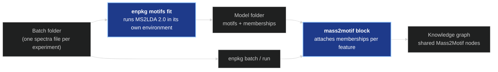
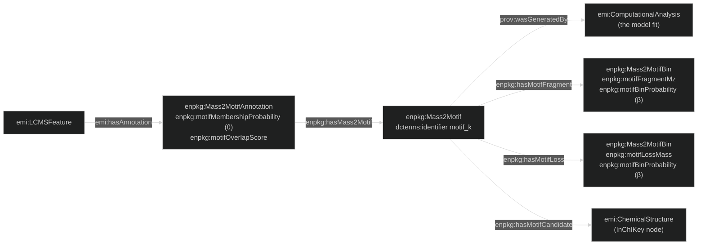

# The Mass2Motif Enhancer — How It Works

*A conceptual walkthrough for presentations and onboarding.*

> Companion to [NETWORK_ENHANCER.md](NETWORK_ENHANCER.md), which also relates features
> through their MS2 spectra, and to [SIRIUS_ENHANCER.md](SIRIUS_ENHANCER.md), the other
> stage that runs an external program. The network links two features whose *whole*
> spectra are similar; this stage links every feature whose spectrum contains a recurring
> *set of fragments and neutral losses* to one shared node for that set, a **Mass2Motif**.
> The method is MS2LDA 2.0 (Torres Ortega et al., *Nat. Commun.* 2026;
> [github.com/vdhooftcompmet/MS2LDA](https://github.com/vdhooftcompmet/MS2LDA)).

---

## 1. What problem does it solve?

Most features in an untargeted dataset get no structure: they match no library spectrum,
and SIRIUS's database search finds no convincing candidate. Class predictors (CANOPUS)
assign them chemical-ontology classes, but a class says nothing about substructures that
recur *across* classes — a hexose (neutral loss of 162.05), a phosphate group, an indole
ring.

**MS2LDA** finds such recurring sets of fragments and losses in the dataset itself, with no
reference library. Each set is a Mass2Motif. One spectrum can contain several motifs, and a
motif occurs in many spectra; many motifs reflect a substructure shared by the molecules
whose spectra contain them. Its **MAG** step (Motif Annotation Guidance) then proposes
library molecules that contain each motif's substructure.

In the knowledge graph, a motif is one node, and every feature whose spectrum contains it
links to it. A motif fitted on many samples is the same node in every sample's graph, so a
query can ask *which samples contain features with this motif*.



---

## 2. The model: LDA applied to spectra

LDA (latent Dirichlet allocation) is a statistical model for collections of count data.
MS2LDA applies it to spectra as follows.

| LDA term | Meaning in MS2LDA |
|---|---|
| Corpus | The set of spectra the model is fitted on |
| Document | One MS2 spectrum |
| Word | One 0.01-Da m/z bin of a fragment (`frag@70.04`) or of a neutral loss, precursor m/z minus fragment m/z (`loss@162.05`) |
| Token count | Intensity: a peak's word is repeated round(relative intensity × 100) times (base peak 100 copies, a 5 % peak 5) |
| Topic = Mass2Motif *k* | A probability distribution **β**ₖ over all words: βₖ(w) is the probability that a token produced by motif *k* is word *w* |
| **θ**_d | For each spectrum *d*, the share of its tokens attributed to each motif (sums to 1 over the motifs) |

**What the model assumes.** Each token of spectrum *d* was produced by drawing a motif *k*
from θ_d, then a word from βₖ. Fitting finds the β shared by all spectra and the θ of each
spectrum that best explain the observed token counts.

**Choices fixed before fitting.** The number of motifs *K* has no default: results change
with it, and the user sets it (`--n-motifs`). The paper's case studies used K = 200 for
2,714 spectra, 250 for a spiked tomato extract, 1,000 for MSnLib and 1,500 for 77k
spectra. MS2LDA's defaults set the priors α = 0.6 on θ (lower: each spectrum is explained by
fewer motifs) and η = 0.01 on β (lower: each motif concentrates on fewer words), and drop
words found in fewer than 3 spectra (`min_df`).

**The overlap score** of spectrum *d* with motif *k* is Σ_w βₖ(w) · φ_d(w, k), where
φ_d(w, k) is the fraction of the copies of word *w* in spectrum *d* that the fit assigned
to motif *k*. The two numbers answer different questions:

- θ: *how much of the spectrum does the motif explain?*
- overlap: *how much of the motif does the spectrum contain?*

A spectrum whose dominant fragment is one of a motif's words can have a high θ for that
motif while containing none of its other words; its overlap is then low. Analyses filter on
θ, overlap, or both — the paper uses θ > 0.1 in one case study and θ > 0.5 in its MSnLib
benchmark.

---

## 3. How MS2LDA computes it

The pipeline runs MS2LDA 2.0.1 unmodified. Its steps, as `MS2LDA.run.run` calls them:

1. **Load and clean** (matchms): metadata filters, then intensities normalised, relative
   intensity 0.01–1 kept, m/z 0–2000 kept, at most 1,000 peaks, at least 5 peaks. Spectra
   that fail are dropped; survivors are numbered `spec_0, spec_1, …`.
2. **Words**, as in §2.
3. **Fit** with tomotopy (a C++ LDA library) by collapsed Gibbs sampling: the sampler keeps
   one motif label on every token of the corpus and repeatedly re-draws each label given all
   the others; the label counts give β and θ. Training runs in steps of 50 iterations and
   stops when perplexity changes by less than 0.005 (relative) over the last 500 iterations,
   or at `--n-iterations`.
4. **Motifs**: the 50 most probable words of each topic, with their β.
5. **MAG** (§4).

What was measured on this project's data (two experiments, 2,499 spectra, 2026-10-06):

- **Reproducibility depends on the thread count.** Three fits with MS2LDA's default thread
  settings gave byte-identical motifs; two single-thread fits were identical to each other
  but different from those. tomotopy itself warns that a fixed seed does not guarantee
  identical results with more than one thread, so another machine may give other motifs.
- **Loss words carry the wrong intensity.** MS2LDA weights each loss word with the
  intensity of the fragment at the same *position* in the fragment list, but matchms lists
  losses in ascending order, i.e. in reverse fragment order. Measured on a spectrum with
  fragments 100 (100 %), 150 (50 %), 200 (10 %) and precursor 300: the loss from the base
  peak (loss 200) gets 10 copies and the loss from the weakest peak (loss 100) gets 100.
  This is in MS2LDA 2.0.1's `features_to_words`, and every fit inherits it.

---

## 4. MAG: Motif Annotation Guidance

A motif is a list of m/z bins; annotating motifs by hand took experts days per 30 motifs
(paper). MAG proposes molecules automatically:

1. The motif's pseudo-spectrum (fragments and losses, β as intensity) is embedded with
   Spec2Vec, a word2vec model trained on 502,685 positive-mode library spectra (MoNA,
   MassBank, GNPS, MSnLib).
2. It is compared by cosine similarity with the embeddings of all those library spectra
   (FAISS, exact search over a matrix held in memory); the top hits come with their SMILES
   from an SQLite library (5 by MS2LDA's CLI default).
3. **Masking:** each motif word is removed in turn, the motif re-embedded, and its
   similarity to the hits recomputed.
4. Hits whose similarity changes alike under masking are grouped by agglomerative
   clustering; MS2LDA's CLI default keeps the largest group. These molecules are taken to
   share the substructure behind the motif.
5. The motif is reduced to the fragments and losses present in all of their spectra (the
   *optimised* motif).

MAG returns **candidate molecules that contain the substructure**, not a SMILES of the
substructure. Reliability (paper): on curated MotifDB motifs the substructure overlap
between MAG and expert annotation averaged 0.72–0.85; on 1,000 motifs fitted to MSnLib,
158 were judged high quality, 176 intermediate and 78 likely wrong, with the rest removed or
without molecules. A single proposed molecule is unreliable; several consistent ones are
more reliable. **MAG exists for positive mode only** — negative-mode fits have no
candidates.

---

## 5. How the pipeline runs it

**The constraint.** MS2LDA 2.0.1 cannot be installed next to the pipeline:

| | MS2LDA 2.0.1 needs | enpkg has |
|---|---|---|
| Python | < 3.13 | ≥ 3.13 |
| pandas | < 3 | ≥ 3 |
| matchms | ≥ 0.27 | 0.20 |

It therefore runs in a separate Python environment, and the pipeline starts it as a
separate process — as it does SIRIUS.

**`enpkg motifs fit`** (`enpkg/scripts/fit_mass2motifs.py`) runs in the enpkg environment:

1. Finds the experiments of the batch folder as `enpkg batch` does (one subfolder per
   experiment, shared metadata at the top, `--experiments-file` to restrict), and leaves
   out runs the metadata marks as blanks or QCs, or does not list.
2. Writes `request.json` into the new model folder.
3. Runs `ms2lda_driver.py` with the MS2LDA environment's interpreter (`--ms2lda-python`,
   or the `MS2LDA_PYTHON` environment variable), first with `--check` (installed versions;
   MAG resources present), then for the fit. A negative-mode fit runs without MAG.

**`ms2lda_driver.py`** runs in the MS2LDA environment and calls MS2LDA's functions in the
order `run()` calls them. Two details:

- **Memberships** come from MS2LDA's own `generate_corpusjson_from_tomotopy`, called as its
  visualisation export calls it. It names document *i* `spec_i`, the name `clean_spectra`
  gives the *i*-th spectrum it keeps, so each document is linked to the run name and
  feature id of its spectrum by position. Measured: the stored values equal those in
  MS2LDA's own `ms2lda_viz.json.gz` exactly (5,343 of 5,343 pairs, difference 0.0).
  MS2LDA's visualisation file additionally links documents to spectra through an MD5 hash of
  the word list, which sends a document to the wrong spectrum when two spectra have identical
  word lists (1 document in 2,260 in the measured fit); the model folder does not use it.
- **Import order on Windows.** pyarrow 17, an MS2LDA dependency, ships `msvcp140.dll`
  14.28; the first copy of that DLL a process loads serves all modules, and tomotopy 0.14
  then crashes (access violation) during training. The driver imports tomotopy first, which
  loads the environment's newer copy.

**MS2LDA's figures and MS2LDAViz file** are written only with `--viz`. Without it, `ms2lda/`
holds the trained model and the motifs in MS2LDA's formats, written in under a second.

**Cost, measured** (43 experiments, 105,801 spectra → 101,813 documents, K = 200, MAG on,
1,000 iterations, with the files `--viz` writes): 94 min and 16.0 GB peak memory. Training
took 27 min, MAG 26 s, the memberships 98 s, and MS2LDA's own output files 62 min —
`save_visualization_data` rebuilds its document-to-spectrum map once per motif. The files the
pipeline reads total 14 MB; the `ms2lda/` folder 1.07 GB. A fit without `--viz` at this scale
was not timed. On two experiments (2,499 spectra, K = 20) the whole fit takes under a minute.

**Setting up the environment** (README): Python 3.12, `ms2lda==2.0.1` with
`matchms>=0.27,<0.30` and `numpy==1.26.4` — MS2LDA's PyPI metadata allows matchms 0.33,
whose removal of `matchms.Spikes` breaks `import MS2LDA` — then `ms2lda --only-download`
for MAG (a 2 GB download; 6.1 GB on disk).

---

## 6. The model folder

| File | Content |
|---|---|
| `motifs.json` | Per motif: its 50 most probable fragments and losses as `[m/z, β]`; with MAG, the optimised fragments and losses and the candidate molecules (SMILES, InChIKey, Spec2Vec score) |
| `documents.parquet` | One row per training spectrum: `doc_id`, `run_name`, `feature_id`, `precursor_mz` |
| `memberships.parquet` | One row per (spectrum, motif) with θ > 0.01: `run_name`, `feature_id`, `motif`, `probability` (θ), `overlap` |
| `manifest.json` | Written last: software versions, merged MS2LDA parameters, experiments with the sha256 of their spectra files, corpus counts, convergence history, timings |
| `ms2lda/` | MS2LDA's trained model (`ms2lda.bin`), `.m2m` motif files and MotifDB JSON. With `--viz`, also its convergence plot, motif figures, motif network, document map, and `ms2lda_viz.json.gz` for MS2LDAViz when K < 500 |
| `request.json`, `fit.log` | What was asked; the driver's log |

The **model id** is a 16-hex-digit hash of `motifs.json`. It names the motifs in the graph,
so two folders with the same motifs give the same IRIs, and a refit with different motifs
gives new ones. The command refuses to write into a non-empty folder.

---

## 7. The block: model folder → data model

The `mass2motif` block (`Mass2MotifConfig`: `model_dir`, `min_probability` = 0.1,
`min_overlap` = 0.0) runs once per experiment:

- **Skipped, with a warning** when the model was fitted in the other ionization mode, or
  when the run was not among the fitted experiments (refit to include it).
- **Stopped, with an error** when the stored precursor m/z of a feature differs from the
  analysis' by more than 0.001 Da (the spectra file changed after the fit), or when the
  run's training spectra repeat a feature id.
- Otherwise each spectrum gets its memberships with θ ≥ `min_probability` and overlap ≥
  `min_overlap` (`AnnotatedSpectrum.motif_memberships`, highest θ first), and the analysis
  gets the whole motif set (`Analysis.motif_set`).

Features MS2LDA's cleaning dropped (fewer than 5 peaks) have no memberships. On the two
measured experiments, 1,126 of 1,274 and 1,097 of 1,225 features received at least one
membership at θ ≥ 0.1.

---

## 8. Serialization: data model → knowledge graph



| IRI | Scope |
|---|---|
| `mass2motifmodel/{model_id}` | One per model |
| `mass2motif/{model_id}/{k}` and its `/fragment/{m/z}`, `/loss/{m/z}` bins | One per motif, the same in every graph built from the model |
| `mass2motifannotation/{run}/{feature_id}/{model_id}/{k}` | One per feature and motif |

A Mass2Motif annotation is an `emi:SpectrumAnnotation` but not an `emi:StructuralAnnotation`:
it names no structure. MAG candidates become the same `identifiers.org/inchikey/…` nodes as
LOTUS compounds and library matches, linked with `enpkg:hasMotifCandidate`, which is not an
identification and is not a subproperty of `emi:hasChemicalStructure`. MAG's similarity score
for each candidate stays in `motifs.json` and is not in the graph. θ and β each have their own
property, and both are `rdfs:subPropertyOf emi:hasProbability`, as EMI's CANOPUS probabilities
are; a query on `emi:hasProbability` finds them only under RDFS inference. Each graph contains
only the motifs its analysis references. Example query — motifs by number of samples:

```sparql
PREFIX emi: <https://w3id.org/emi#>
PREFIX enpkg: <https://w3id.org/enpkg#>
PREFIX dcterms: <http://purl.org/dc/terms/>
SELECT ?motif (COUNT(DISTINCT ?analysis) AS ?samples) (COUNT(DISTINCT ?feature) AS ?features)
WHERE {
  ?analysis emi:hasLCMSFeatureSet/emi:hasLCMSFeature ?feature .
  ?feature emi:hasAnnotation ?annotation .
  ?annotation a enpkg:Mass2MotifAnnotation ;
              enpkg:hasMass2Motif/dcterms:identifier ?motif ;
              enpkg:motifMembershipProbability ?theta .
  FILTER(?theta >= 0.3)
}
GROUP BY ?motif ORDER BY DESC(?samples)
```

---

## 9. Caveats

- **Memberships exist only for experiments in the fit.** A new experiment needs a refit.
- **The corpus counts a compound once per sample.** The fit uses each experiment's own
  feature list, so a compound detected in many samples contributes many near-identical
  spectra and draws motifs towards frequent compounds. MS2LDA's case studies fitted aligned
  feature lists or libraries, where a compound appears about once. (Inference from the
  model's design; not measured.)
- **K is the user's choice**, and results vary with it and with the thread count (§3).
- **Loss words are mis-weighted** by MS2LDA 2.0.1 (§3).
- **MAG is positive-mode only**, and its candidates are guidance, not identifications.
- **Candidate SMILES can disagree between sources.** `emi:hasSMILES` is functional; a
  structure node that receives different SMILES strings from MAG and from a spectral library
  in two merged graphs makes the merged graph inconsistent. This exists for library matches
  already; MAG adds one more source.

---

## 10. Why it's built this way

- **A separate environment**, because the Python version requirements of MS2LDA 2.0.1 and
  of the pipeline do not overlap (§5); MS2LDA itself then runs unmodified.
- **A separate fit command**, because LDA learns from a whole corpus while the pipeline
  processes one experiment at a time; fitting once on all experiments of a batch gives
  motifs shared by every sample, and building the model before the pipeline runs keeps the
  batch runner unchanged — the same arrangement as the DuckDB database, built by
  `enpkg db` and only read by the pipeline.
- **Training-run memberships**, because those are the values MS2LDA itself reports, and
  reading them from files means pipeline runs never need the MS2LDA environment.
- **A model id from the motifs' content**, so motif IRIs depend only on the motifs.

---

### One-line summary

> **`enpkg motifs fit` runs MS2LDA 2.0 unmodified in its own environment over every
> experiment of a batch, storing the motifs, their MAG candidate molecules and each
> spectrum's training-run memberships in a model folder; the `mass2motif` block attaches
> those memberships to each experiment's features, and the serializer links every feature
> to shared `enpkg:Mass2Motif` nodes that carry their fragment and loss bins.**
